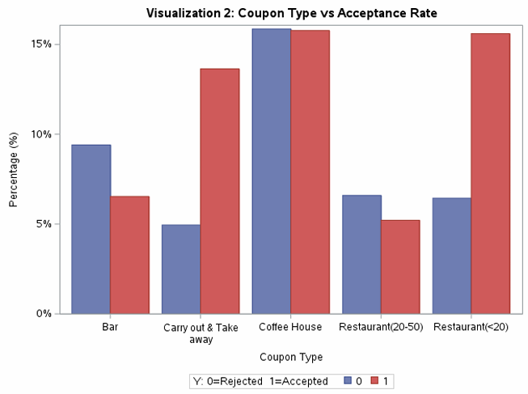
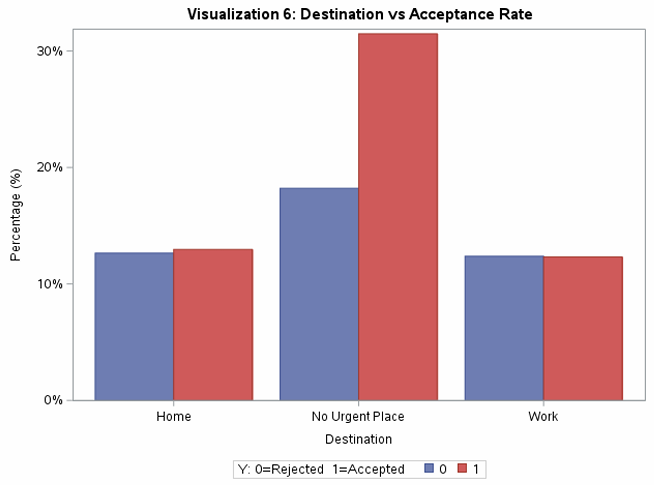
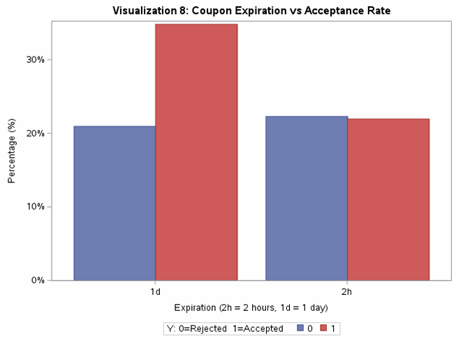
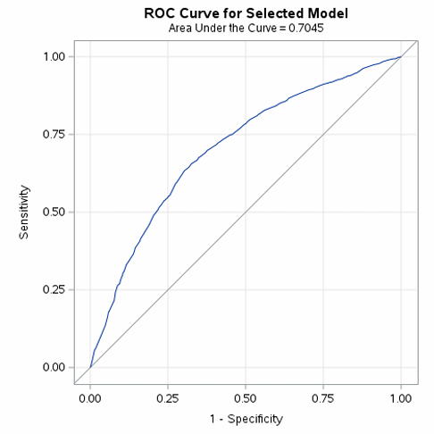
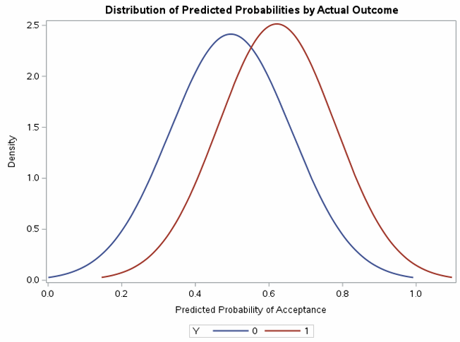

# In-Vehicle Coupon Acceptance Prediction (SAS)

An end-to-end data science project in SAS that explores, cleans, engineers features for, and models the In-Vehicle Coupon Recommendation dataset (12,684 survey responses). The goal is to predict whether a driver will accept a coupon given the driving context (destination, passengers, weather, time, coupon type, expiration) and the driver's habits, so that offers can be sent only to drivers likely to accept them and advertising spend is not wasted.

## Demo

*Coupon Type vs. Acceptance*



*Destination vs. Acceptance*



*Coupon Expiration vs. Acceptance*



*Logistic Regression ROC Curve (Training Data)*



*Predicted Probability of Acceptance by Actual Outcome*



## Features

- **Full Data Science Lifecycle in SAS:** Data import and profiling, EDA, cleaning, feature engineering, modeling, and evaluation, all in one reproducible script.
- **In-Depth EDA:** 12 visualizations of acceptance against contextual, demographic, and distance features, plus correlation analysis, univariate normality tests, cross-tabulated acceptance rates, and IQR outlier detection with box plots.
- **Documented Data Cleaning:** Removes duplicates, drops an unusable column, imputes missing values, and standardizes inconsistent category codes, with before/after validation reports.
- **Leakage-Safe Pipeline:** The train/test split happens before imputation and scaling. The age mean and the scaling statistics are learned on the training set only and then applied to the test set.
- **Engineered Features:** Five new features (distance level, habit match, companion logic, bad-weather-at-home flag, urgency score) plus ordinal encoding of visit-frequency columns.
- **Two Classification Models:** Stepwise Logistic Regression for interpretability and K-Nearest Neighbors (K=5) as a non-linear alternative, compared on the same held-out test set.
- **Reusable Macros:** `%clean_subset` and `%do_feature_engineering` apply identical transformations to the train and test sets.

## Tech Stack

- **Language:** SAS (developed in SAS Studio / SAS OnDemand for Academics)
- **SAS Procedures:**
  - `PROC IMPORT`, `PROC CONTENTS`, `PROC SORT`, `PROC SQL`, `PROC FORMAT`: Data loading, profiling, de-duplication
  - `PROC MEANS`, `PROC FREQ`, `PROC CORR`, `PROC UNIVARIATE`: Descriptive statistics and EDA
  - `PROC SGPLOT`, `PROC GCHART`: Visualizations
  - `PROC SURVEYSELECT`: 80/20 train/test split
  - `PROC STDIZE`: Standardization of numeric features
  - `PROC LOGISTIC`: Logistic Regression with stepwise selection
  - `PROC DISCRIM`: K-Nearest Neighbors
- **Techniques:** DATA step programming, SAS macros, arrays, mean imputation, ordinal encoding, Z-score scaling
- **Algorithms:** Logistic Regression (stepwise), K-Nearest Neighbors (K=5)
- **Data Source:** [In-Vehicle Coupon Recommendation dataset (UCI Machine Learning Repository)](https://archive.ics.uci.edu/dataset/603/in+vehicle+coupon+recommendation)

## Dataset

Respondents were placed in simulated driving scenarios and asked whether they would use a coupon for a nearby venue. The dataset has 26 columns:

| Group | Columns |
|---|---|
| **Context** | `destination`, `passanger`, `weather`, `time`, `temperature`, `expiration`, `coupon` |
| **Demographics** | `gender`, `age`, `maritalStatus`, `has_children`, `education`, `occupation`, `income`, `car` |
| **Visit habits** | `Bar`, `CoffeeHouse`, `CarryAway`, `RestaurantLessThan20`, `Restaurant20To50` |
| **Distance / Direction** | `direction_same`, `direction_opp`, `toCoupon_GEQ5min`, `toCoupon_GEQ15min`, `toCoupon_GEQ25min` |
| **Target** | `Y` (1 = coupon accepted, 0 = rejected) |

*Note: `passanger` is spelled as it appears in the original dataset.*

## Methodology

1. **Data Quality Audit:** 12,684 rows and 26 columns. Missing values in `age` (2,325), `car` (99%), and the five visit-frequency columns (107 to 217 each), plus 74 duplicate rows.
2. **Cleaning:**
   - Removed 74 duplicates (12,610 rows remain).
   - Dropped `car` (99.14% missing, effectively unusable).
   - Split the data 80/20 with simple random sampling (10,088 train / 2,522 test, `SEED=12345`).
   - Imputed missing `age` with the training-set mean, rounded to a whole number, and applied the same value to the test set.
   - Filled missing visit-frequency values with the most common category and standardized inconsistent codes (`les`, `l`, `1`, `4`, `g`, and others) into five labels from `Never` to `More than 8 times`.
3. **Feature Engineering:**
   - `Total_Distance_Level`: sum of the three distance flags.
   - `Coupon_Habit_Match`: 1 if the driver already visits this type of venue at least once a month.
   - `Companion_Logic`: 0 when kids are in the car and the coupon is for a bar.
   - `Bad_Weather_Home_Flag`: 1 when it is rainy or snowy and the driver is heading home.
   - `Urgency_Score` (1 to 4): combines expiration window and distance. A higher score means more time to use the coupon (1 = 2-hour coupon for a far venue, 4 = 1-day coupon).
   - Ordinal encoding (0 to 4) of the five visit-frequency columns.
   - Dropped the three distance flags after combining them.
4. **Scaling:** Z-score standardization of `temperature` and `age`, with the test set scaled using the training-set statistics (`PROC STDIZE ... METHOD=IN`).
5. **Modeling:** Logistic Regression with stepwise selection and K-Nearest Neighbors (K=5), both trained on the training set and evaluated on the test set.

## Results

### Test Set Performance (2,522 observations)

| Model | Accuracy | Recall (Accepted) | Recall (Rejected) | Precision (Accepted) |
|---|---|---|---|---|
| Majority-class baseline | 58.0% | 100% | 0% | 58.0% |
| **Logistic Regression (stepwise)** | **67.6%** | **73.7%** | 59.2% | **71.4%** |
| K-Nearest Neighbors (K=5) | 64.9% | 67.3% | **61.6%** | 70.7% |

Logistic Regression confusion matrix (rows = actual, columns = predicted):

| | Predicted Reject | Predicted Accept |
|---|---|---|
| **Actual Reject** | 628 | 432 |
| **Actual Accept** | 385 | 1,077 |

### Logistic Regression: Selected Features

Stepwise selection (entry at p < 0.05) kept five predictors. The model reaches an AUC of 0.7045 on the training data.

| Feature | Odds Ratio | 95% CI | Effect on Acceptance |
|---|---|---|---|
| `Coupon_Habit_Match` | 3.864 | 3.537 to 4.222 | Strongly increases |
| `Urgency_Score` | 1.456 | 1.388 to 1.526 | Increases (longer window and shorter distance) |
| `temperature` (per 1 SD) | 1.128 | 1.080 to 1.178 | Increases |
| `Total_Distance_Level` | 0.890 | 0.831 to 0.952 | Decreases |
| `CarryAway_num` | 0.915 | 0.874 to 0.959 | Slightly decreases |

### Key Findings

- **Matching the coupon to the driver's habits is the biggest lever:** drivers are almost four times as likely (odds) to accept a coupon for a type of venue they already visit.
- **Coupon type matters a lot:** Carry out & Take away (73.4%) and Restaurant (<$20) (70.8%) coupons are accepted most, while Bar (41.0%) and Restaurant ($20 to $50) (44.2%) coupons are accepted least.
- **Context changes everything:**
  - Friends in the car plus a cheap restaurant coupon reaches 80.1% acceptance.
  - Kids in the car plus a bar coupon drops to 21.1%.
  - Drivers with no urgent destination accept far more than those heading home or to work.
- **Longer validity windows help:** 1-day coupons are accepted more than 2-hour coupons, e.g. cheap restaurant coupons reach 83.1% with a 1-day window, and expensive restaurant coupons fall to 29.9% with a 2-hour window.
- **Nearby and on-route venues win:** acceptance falls as the venue gets farther away and rises with warmer temperatures.
- **No single numeric variable is a strong linear predictor:** all significant correlations with acceptance are weak (|r| < 0.11), which is why habit, context, and engineered features carry the model.
- **Logistic Regression beats KNN on accuracy (67.6% vs 64.9%)** and is easier to interpret. KNN fits the training data noticeably better than the test data (26.5% vs 35.6% balanced error rate), which suggests overfitting.

### How It Helps Decision Making

- Target drivers whose habits match the coupon being offered.
- Prefer longer validity windows and nearby venues.
- Avoid pushing bar coupons to drivers travelling with children, and avoid sending offers to drivers heading home in bad weather.

## Getting Started

### Prerequisites
- SAS 9.4 or SAS OnDemand for Academics (SAS Studio)

### Installation

Clone the repository:
```bash
git clone https://github.com/YourUsername/in-vehicle-coupon-acceptance-prediction-sas.git
cd in-vehicle-coupon-acceptance-prediction-sas
```

Upload `coupon_acceptance_analysis.sas` and `data/in-vehicle-coupon-recommendation.csv` to your SAS environment (for SAS OnDemand, use the Server Files and Folders pane).

### Usage

Open the `FILENAME` statement at the top of the script and point it to where you uploaded the CSV:
```sas
FILENAME REFFILE '/home/<your-username>/<your-folder>/in-vehicle-coupon-recommendation.csv';
```

Then run the script from top to bottom. The output (tables and charts) appears in the Results tab, and the final datasets (`train_ready`, `test_ready`, `final_predictions`, `knn_results`) are created in the `WORK` library. A saved copy of a full run is in `docs/sas_output_results.pdf`.

## Limitations and Future Work

- Stepwise selection only considered numeric and ordinal predictors. Strong categorical signals found in the EDA (`coupon`, `passanger`, `destination`, `weather`) were not candidates, so adding them (as dummy variables or interaction terms) is the most promising way to improve the 0.70 AUC.
- `Companion_Logic` and `Bad_Weather_Home_Flag` were engineered but not used in the final model.
- The reported ROC and AUC come from the training data. Adding test-set ROC and AUC, and k-fold cross-validation, would give a more reliable estimate.
- Tune the classification cutoff to the business cost of a wasted offer versus a missed one, and tune `K` for KNN.
- The dataset has no respondent ID, so duplicate removal may discard legitimate identical responses.
